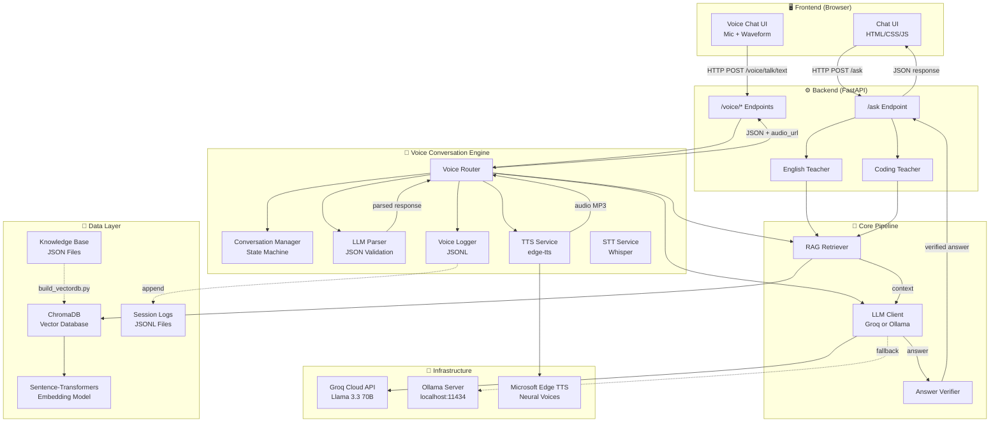
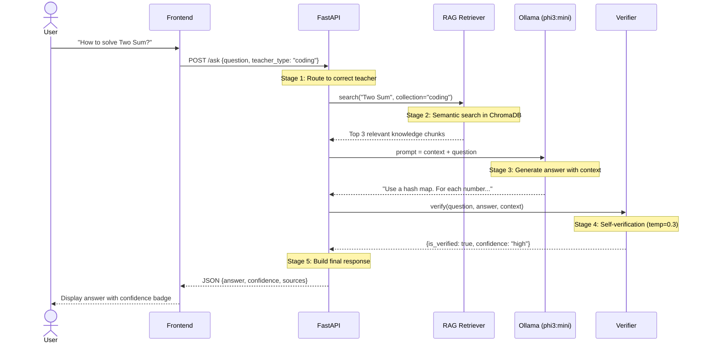
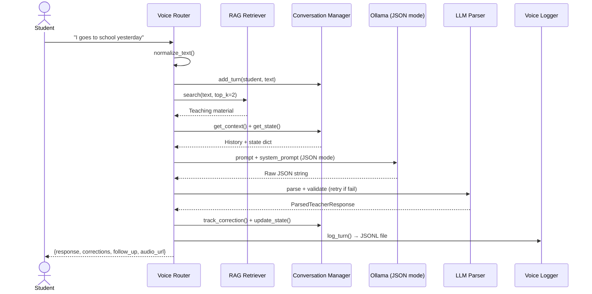

# 🎓 AI Teacher — System Design Document

> A privacy-first AI teaching system with dual LLM support (local + cloud), voice I/O, and native language support.

| Spec           | Value                        |
| -------------- | ---------------------------- |
| **Python**     | 3.10 – 3.12 (⚠️ 3.13+ not supported) |
| **Hardware**   | GTX 1650 GPU, 16GB RAM       |
| **LLM (Cloud)**| Groq API → Llama 3.3 70B (default, free) |
| **LLM (Local)**| Ollama → phi3:mini (offline fallback) |
| **TTS**        | edge-tts (Microsoft Neural Voices) |
| **STT**        | OpenAI Whisper (local, base.en) |
| **Vector DB**  | ChromaDB (local, persistent) |
| **Embeddings** | all-MiniLM-L6-v2 (384-dim)   |
| **Backend**    | Python FastAPI               |
| **Frontend**   | React + Vite + TypeScript    |
| **Styling**    | Tailwind CSS v4 + shadcn/ui  |
| **DevOps**     | Docker, GitHub Actions       |

---

## 1. System Architecture



---

## 2. The Pipeline — How a Question Gets Answered

Every question flows through 5 stages:



### Why this order matters

| Stage               | What                        | Why                                           | Without it                         |
| ------------------- | --------------------------- | --------------------------------------------- | ---------------------------------- |
| **1. Route**        | Pick English/Coding teacher | Different system prompts, different knowledge | Wrong personality, wrong data      |
| **2. RAG Search**   | Find relevant knowledge     | Give LLM factual reference material           | Hallucination — LLM makes stuff up |
| **3. LLM Generate** | Create answer with context  | Context = "open book exam" for the AI         | Unreliable answers                 |
| **4. Verify**       | Double-check the answer     | Catch obvious factual errors                  | Wrong info reaches the user        |
| **5. Respond**      | Send to user with metadata  | Confidence score helps user judge reliability | User blindly trusts everything     |

---

## 3. Component Deep Dive

### 3.1 RAG Retriever — `backend/app/rag/retriever.py`

**One-line:** Takes a question → finds the most relevant knowledge from ChromaDB.

```
User Question → Embedding Model (text → 384 numbers) → ChromaDB Search → Top 3 Results
```

**Key design decisions:**

| Decision             | Choice           | Rationale                                      |
| -------------------- | ---------------- | ---------------------------------------------- |
| Embedding model      | all-MiniLM-L6-v2 | Only 80MB, runs on CPU, good quality for size  |
| Vector dimensions    | 384              | Balance between accuracy and speed             |
| Top-K results        | 3                | Sweet spot — enough context without noise      |
| Separate collections | english / coding | Prevents cross-contamination of search results |

**Core methods:**

```python
# Search — returns ranked results with distance scores
results = retriever.search("How to reverse linked list?", teacher_type="coding")
# → [{"text": "...", "topic": "Reverse a Linked List", "distance": 0.61}, ...]

# Format — converts results into LLM-readable context
context = retriever.format_context(results)
# → "[Source 1] (Topic: Reverse a Linked List)\n..."
```

**What is "distance"?** Lower = better match. Think of it as GPS distance — 0.6 means very close (similar meaning), 1.5 means far (different topic).

---

### 3.2 LLM Clients — Dual Provider Architecture

**One-line:** Switchable LLM backend — Groq (cloud, fast, better Hinglish) or Ollama (local, offline fallback).

```
Config: LLM_PROVIDER = "groq" | "ollama"

[Groq path]:   Prompt → Groq API → Llama 3.3 70B → JSON Response  (2-5 sec)
[Ollama path]: Prompt → Ollama API → phi3:mini → JSON Response     (15-20 sec)
```

**Files:**

| File | Class | API | Best For |
|------|-------|-----|----------|
| `ollama_client.py` | `OllamaClient` | Ollama REST API | Offline mode, English |
| `groq_client.py` | `GroqClient` (inherits OllamaClient) | Groq OpenAI-compatible API | Hinglish, Hindi, speed |

**Inheritance pattern:** `GroqClient` inherits prompt-building methods from `OllamaClient`, only overrides `generate()` and `generate_voice_response()` — same prompts, different API.

**Voice-specific methods (shared via inheritance):**

| Method | Purpose |
|--------|---------|
| `generate_voice_response()` | JSON-mode LLM call with timeout + fallback |
| `build_voice_conversation_prompt()` | Emma's system prompt + language instructions + state + RAG |
| `build_voice_retry_prompt()` | Stricter prompt for retry when JSON parse fails |
| `_get_language_example()` | Few-shot Hinglish/Hindi examples (helps smaller models) |

**Temperature explained:**

```
🧊 0.0 ──── 0.3 ──── 0.5 ──── 0.7 ──── 1.0 🔥
   |          |         |         |         |
 Robotic   Verifier  Retry     Teacher   Poet
 (exact)   (strict)  (voice)   (our     (wild)
                                pick)
```

---

### 3.3 Answer Verifier — `backend/app/verification/verifier.py`

**One-line:** Takes LLM's answer → asks the same LLM "is this correct?" → returns confidence score.

```
LLM's Answer → Verification Prompt → Same LLM (temp=0.3) → Parse → Verdict
  CORRECT       → ✅ confidence: high
  PARTIALLY     → ⚠️ confidence: medium
  INCORRECT     → ❌ confidence: low + corrected answer
```

**Why temp=0.3 for verification?** Verification needs to be strict — no creativity. Like a math teacher grading papers.

> ⚠️ **Note:** Self-verification is NOT 100% reliable (same LLM checks itself). But it catches ~60-70% of obvious errors.

---

### 3.4 Teachers — `backend/app/teachers/`

**One-line:** Each teacher is a personality wrapper around the same RAG+LLM+Verifier pipeline.

| File                 | Class            | System Prompt                                              | Knowledge Collection |
| -------------------- | ---------------- | ---------------------------------------------------------- | -------------------- |
| `english_teacher.py` | `EnglishTeacher` | "Friendly English teacher, correct grammar, give examples" | `english_knowledge`  |
| `coding_teacher.py`  | `CodingTeacher`  | "Coding tutor, explain DSA, mention complexity"            | `coding_knowledge`   |

**Design Pattern — Duck Typing:**

```python
# Both teachers have the SAME method signature:
english_teacher.ask(question) → {answer, confidence, sources, ...}
coding_teacher.ask(question)  → {answer, confidence, sources, ...}

# So main.py doesn't care WHICH teacher — just call .ask()!
teacher = pick_teacher(teacher_type)  # could be either
result = teacher.ask(question)        # same interface!
```

---

### 3.5 FastAPI Application — `backend/app/main.py`

**One-line:** The entry point that receives HTTP requests, routes to the correct teacher, and returns JSON responses.

**Endpoints:**

| Method | Path | Purpose | Request Body |
|--------|------|---------|--------------|
| `GET` | `/health` | Check if server + Ollama are running | None |
| `POST` | `/ask` | Ask a question to a teacher | `{question, teacher_type, verify}` |
| `POST` | `/ask/stream` | Streaming response (SSE) | `{question, teacher_type, verify}` |
| `POST` | `/voice/start` | Start a new voice session | `{student_level, native_language}` |
| `POST` | `/voice/talk/text` | **Core** — text conversation with Emma | `{session_id, text}` |
| `GET` | `/voice/audio/{filename}` | Serve TTS audio file (MP3) | Path param |
| `GET` | `/voice/history/{id}` | Get conversation history | Path param |
| `GET` | `/voice/corrections/{id}` | Get correction report card | Path param |

**Startup flow:**

```
Server starts → Load RAGRetriever (embedding model + ChromaDB)
             → Check LLM_PROVIDER config
             → "groq"  → Load GroqClient (cloud, Llama 70B)
             → "ollama" → Load OllamaClient (local, phi3:mini)
             → Load AnswerVerifier (uses whichever LLM client)
             → Create EnglishTeacher + CodingTeacher
             → Init TTSService (edge-tts, voice config)
             → Init VoiceRouter (retriever + llm_client + tts_service)
             → Mount voice router at /voice/*
             → Ready!
```

---

### 3.6 Voice Conversation Engine — `backend/app/voice/`

**One-line:** A multi-turn, state-aware voice English teaching system with intelligent correction tracking, adaptive difficulty, and structured logging.



**Component breakdown:**

| File | Class/Functions | Responsibility |
|------|-----------------|----------------|
| `conversation_manager.py` | `ConversationManager`, `ConversationSession`, `ConversationState` | Session state machine, error tracking, debouncing, level adjustment |
| `llm_parser.py` | `parse_llm_response_with_retry()`, `normalize_text()` | JSON parse chain (direct → regex → retry → fallback), strict enum validation |
| `logger.py` | `VoiceLogger` | JSONL structured logging per session with latency tracking |
| `voice_router.py` | FastAPI `APIRouter` with 5 endpoints | Orchestrator — ties all components together |
| `tts_service.py` | `TTSService` | Text-to-Speech via edge-tts (Microsoft Neural Voices) |
| `stt_service.py` | `STTService` | Speech-to-Text via Whisper (local, base.en model) |
| `ollama_client.py` | Prompt building + Ollama API calls | Base LLM client (inherited by GroqClient) |
| `groq_client.py` | `GroqClient(OllamaClient)` | Cloud LLM via Groq API (inherits prompts) |

### 3.7 Voice I/O — TTS & STT

**TTS (Text-to-Speech) — `voice/tts_service.py`:**

```
Emma's text → edge-tts (Microsoft) → MP3 audio → Serve via /voice/audio/{file}
```

| Feature | Detail |
|---------|--------|
| Library | edge-tts (free, no API key) |
| Voices | Jenny (English), Neerja (Indian English/Hinglish), Swara (Hindi) |
| Speed | +5% (natural conversational pace) |
| Output | MP3, temp files with auto-cleanup |
| Backup | 3 fallback voices if primary fails |

**STT (Speech-to-Text) — `voice/stt_service.py`:**

```
Student audio → Whisper (local) → Transcribed text → LLM pipeline
```

| Feature | Detail |
|---------|--------|
| Library | openai-whisper (local, no API) |
| Model | base.en (~140MB, English-only) |
| Max audio | 20 seconds, 5MB |
| Primary | Frontend Web Speech API (lower latency) |
| Whisper | Backend fallback when browser STT unavailable |

### 3.8 Native Language Support

**Emma adapts her language based on `native_language`:**

| Language | Teaching Style | TTS Voice | LLM Quality |
|----------|---------------|-----------|-------------|
| `english` | Pure English explanations | en-US-JennyNeural | ⭐⭐⭐⭐⭐ |
| `hinglish` | Hindi-English mix explanations | en-IN-NeerjaNeural | ⭐⭐⭐⭐⭐ (Groq) / ⭐⭐ (Ollama) |
| `hindi` | Hindi explanations, English grammar terms | hi-IN-SwaraNeural | ⭐⭐⭐⭐ (Groq) |

**How it works:**

```
Session start (native_language="hinglish")
  → System prompt adds CRITICAL language rules
  → Few-shot Hinglish JSON example injected in prompt
  → TTS voice switched to Indian English (NeerjaNeural)
  → Greeting in Hinglish: "Hi! Main Emma hoon, chalo practice shuru karte hain!"
```

**Error tracking & adaptive learning:**

```
Student makes mistake → Correction tracked (with ErrorType enum)
                      → Mistake count incremented
                      → Same mistake 2+ times? → State switches to grammar_drill
                      → Error rate calculated over last 10 turns
                      → Student level auto-adjusts (beginner/intermediate/advanced)
```

**Safety guardrails:**

| Guardrail | What | Why |
|-----------|------|-----|
| Max 2 corrections/turn | Cap corrections array | Don't overwhelm student |
| Correction debouncing | Skip if same error corrected last turn | Avoid repetitive feedback |
| 80-word response cap | Truncate at sentence boundary | Voice output must be concise |
| Grammar drill loop guard | Max 3 turns in drill mode | Prevent getting stuck |
| 60s LLM timeout | Return fallback JSON | Student shouldn't wait forever |
| JSON retry | Stricter prompt on parse failure | LLMs sometimes break format |
| Strict enum validation | Reject unknown error_type | Protect tracking integrity |

---

## 4. Data Architecture

### Knowledge Base Stats

| Collection | Items | Categories                                                                                       |
| ---------- | ----- | ------------------------------------------------------------------------------------------------ |
| English    | 41    | Grammar (12), Vocabulary (5), Conversation (5), Writing (2), Pronunciation (6), Company Scenarios (6), Speaking Scenarios (5) |
| Coding     | 14    | Arrays (3), Strings (2), Linked List (2), Stack (1), Trees (2), DP (2), Search (1), Hash Map (1) |

---

## 5. Project Structure

```
ai-teacher/
├── backend/
│   ├── app/
│   │   ├── config.py                 # All settings in one place
│   │   ├── main.py                   # FastAPI app — entry point
│   │   ├── rag/retriever.py          # Semantic search
│   │   ├── verification/verifier.py  # Double-check answers
│   │   ├── llm/                      # 🧠 LLM Clients
│   │   │   ├── ollama_client.py      # Local LLM (phi3:mini) + prompt builders
│   │   │   └── groq_client.py        # Cloud LLM (Llama 70B, inherits OllamaClient)
│   │   ├── teachers/
│   │   │   ├── english_teacher.py    # English teacher personality
│   │   │   └── coding_teacher.py     # Coding teacher personality
│   │   ├── services/                 # Business logic (future)
│   │   └── voice/                    # 🎤 Voice Conversation Engine
│   │       ├── __init__.py
│   │       ├── conversation_manager.py  # State machine + error tracking
│   │       ├── llm_parser.py            # JSON parse + validate + retry
│   │       ├── logger.py                # JSONL structured logging
│   │       ├── voice_router.py          # API endpoints (the orchestrator)
│   │       ├── tts_service.py           # Text-to-Speech (edge-tts)
│   │       └── stt_service.py           # Speech-to-Text (Whisper)
│   ├── data/kb/                      # Knowledge base JSONs
│   ├── chroma_db/                    # Vector database (auto-generated)
│   ├── logs/voice_sessions/          # Session logs (JSONL, gitignored)
│   └── scripts/                      # Setup & utility scripts
├── frontend/                         # React + Vite + TypeScript
│   ├── src/
│   │   ├── main.tsx                  # React entry point
│   │   ├── App.tsx                   # Root component
│   │   ├── index.css                 # Global styles + Tailwind
│   │   ├── components/               # Reusable UI blocks
│   │   ├── pages/                    # Full pages (Chat, Topics)
│   │   └── services/                 # API communication layer
│   ├── package.json                  # Node dependencies
│   └── vite.config.ts                # Vite configuration
├── docs/                             # This documentation
├── docker-compose.yml                # Container orchestration
├── .github/workflows/                # CI/CD pipelines
├── requirements.txt
└── README.md
```

---

## 6. Complete Tech Stack

### Frontend

| Technology     | Version | Purpose                                           |
| -------------- | ------- | ------------------------------------------------- |
| React          | 19.x    | UI framework — component-based architecture       |
| Vite           | 7.x     | Build tool — blazing fast HMR, instant dev server |
| TypeScript     | 5.x     | Type safety — catch bugs at compile time          |
| Tailwind CSS   | v4      | Utility-first CSS — rapid UI development          |
| shadcn/ui      | latest  | Premium UI components — buttons, dialogs, cards   |
| Framer Motion  | 12.x    | Smooth animations — transitions, gestures         |
| Zustand        | 5.x     | State management — simple, fast, 10-line setup    |
| React Router   | v7      | Page routing — Topics page, Chat page             |
| Lucide React   | latest  | Icon library — 1500+ clean icons                  |
| Axios          | 1.x     | HTTP client — API calls with interceptors         |
| TanStack Query | v5      | Server state — caching, retries, loading states   |
| Vitest         | latest  | Unit testing — fast, Vite-native                  |

### Backend

| Technology                 | Purpose                            |
| -------------------------- | ---------------------------------- |
| Python 3.10–3.12           | ⚠️ 3.13+ breaks ChromaDB (Pydantic v1 incompatibility) |
| Python FastAPI             | REST API framework                 |
| Groq API (Llama 3.3 70B)  | Cloud LLM — fast, excellent Hinglish (default) |
| Ollama + phi3:mini (2.2GB) | Local LLM — offline fallback |
| edge-tts                   | Text-to-Speech (Microsoft Neural Voices) |
| openai-whisper             | Speech-to-Text (local, base.en model) |
| ChromaDB                   | Vector database for RAG            |
| Sentence-Transformers      | Text embeddings (all-MiniLM-L6-v2) |
| Pydantic                   | Request/response validation        |

### Future Additions

| Technology        | Purpose             | Status |
| ----------------- | ------------------- | ------ |
| React Three Fiber | 3D avatar rendering | 🔲 Future |
| Ready Player Me   | Avatar generator    | 🔲 Future |
| Rhubarb Lip Sync  | Avatar lip syncing  | 🔲 Future |

---

## 7. DevOps Pipeline

```
Developer pushes code
        ↓
Husky (pre-commit)
├── ESLint check (code quality)
├── Prettier format (code style)
└── Type check (TypeScript)
        ↓
GitHub Actions (CI)
├── Install dependencies
├── Run linter
├── Run frontend tests (Vitest)
├── Run backend tests (Pytest)
└── Build check (npm run build)
        ↓
Deploy (CD) — on main branch
├── Frontend → Vercel (auto-deploy)
└── Backend → Railway / Render
```

---

## 8. Design Patterns

| Pattern                    | Where                          | What it does                                |
| -------------------------- | ------------------------------ | ------------------------------------------- |
| **RAG**                    | Retriever + LLM                | Grounds LLM responses in factual data       |
| **Self-Verification**      | Verifier                       | Same LLM reviews its own answer             |
| **Dependency Injection**   | Verifier takes LLM client, Voice Router takes retriever + llm | Swap components without changing consumer code |
| **Duck Typing**            | EnglishTeacher / CodingTeacher | Same `.ask()` interface, different behavior |
| **State Machine**          | ConversationManager            | Mode transitions: free_talk → grammar_drill → free_talk |
| **Sliding Window Memory**  | ConversationSession            | Cap at 16 turns + LLM summary for older context |
| **Strict Enum Validation** | LLM Parser                     | Reject unknown error_type — protect tracking integrity |
| **Graceful Degradation**   | LLM Parser, Logger             | Never crash — fallback responses, swallowed log errors |
| **Component Architecture** | React frontend                 | Reusable, isolated UI blocks                |
| **Single Source of Truth** | config.py, Zustand stores      | All settings/state in one place             |
| **Pipeline**               | RAG → LLM → Verify / Parse     | Each stage transforms data for the next     |
| **Separation of Concerns** | rag/ llm/ verification/ voice/ | Each module does ONE job well               |

---

## 9. Build Progress

| Phase             | Step                  | Status     | Tech                           |
| ----------------- | --------------------- | ---------- | ------------------------------ |
| **Foundation**    | 1. Ollama test        | ✅ Done    | `scripts/test_ollama.py`       |
|                   | 2. Knowledge Base     | ✅ Done    | `data/kb/*.json` (41 items)    |
|                   | 3. Vector DB          | ✅ Done    | `scripts/build_vectordb.py`    |
| **Core Pipeline** | 4. RAG Retriever      | ✅ Done    | `app/rag/retriever.py`         |
|                   | 5. LLM Client         | ✅ Done    | `app/llm/ollama_client.py`     |
|                   | 6. Verifier           | ✅ Done    | `app/verification/verifier.py` |
| **API**           | 7. FastAPI            | ✅ Done    | `app/main.py`                  |
|                   | 8. Teachers           | ✅ Done    | `app/teachers/*.py`            |
| **Voice Engine**  | 9. Conversation Mgr   | ✅ Done    | `voice/conversation_manager.py` |
|                   | 10. LLM Parser        | ✅ Done    | `voice/llm_parser.py`          |
|                   | 11. Voice Logger      | ✅ Done    | `voice/logger.py`              |
|                   | 12. Voice Prompts     | ✅ Done    | `llm/ollama_client.py` (voice methods) |
|                   | 13. Voice Router      | ✅ Done    | `voice/voice_router.py`        |
|                   | 14. Text endpoint     | ✅ Tested  | `/voice/talk/text` working     |
| **Voice I/O**     | 15. TTS (edge-tts)    | ✅ Done    | `voice/tts_service.py`         |
|                   | 16. STT (Whisper)     | ✅ Done    | `voice/stt_service.py`         |
|                   | 17. Groq Integration  | ✅ Done    | `llm/groq_client.py`           |
|                   | 18. Native Language   | ✅ Tested  | Hinglish + Hindi support       |
|                   | 19. Audio serving     | ✅ Tested  | `/voice/audio/{file}` endpoint |
| **Frontend**      | 20. React+Vite setup  | ✅ Done    | TypeScript template            |
|                   | 21. Tailwind + shadcn | ✅ Done    | Tailwind v4, shadcn Nova       |
|                   | 22. Chat UI           | ✅ Done    | Components + Zustand + API     |
|                   | 23. Voice Chat UI     | 🔲 Planned | Mic button + waveform          |
|                   | 24. Topics UI         | 🔲 Planned | Udemy-style course view        |
| **DevOps**        | 25. Docker            | 🔲 Planned | Containerization               |
|                   | 26. GitHub Actions    | 🔲 Planned | CI/CD pipeline                 |
| **Avatar**        | 27. 3D Avatar         | 🔲 Future  | React Three Fiber              |

---

## 10. Performance Benchmarks

### Groq (Cloud) — Default

| Operation                      | Time     | Notes                                   |
| ------------------------------ | -------- | --------------------------------------- |
| RAG Search                     | ~0.5s    | Embedding model cached after first load |
| **Voice LLM (Groq JSON)**      | **~0.7s** | **Llama 70B, JSON-forced, 512 tokens** |
| **TTS (edge-tts)**             | **~5s**   | **Microsoft Neural Voice, MP3** |
| **Voice total (end-to-end)**   | **~6s**  | **RAG + LLM + TTS + parse**   |
| Server startup                 | ~10s     | ChromaDB + embedding model |

### Ollama (Local) — Fallback

| Operation                      | Time     | Notes                                   |
| ------------------------------ | -------- | --------------------------------------- |
| LLM Generation (no verify)     | ~30s     | phi3:mini, single pass |
| **Voice LLM (JSON mode)**      | **~15-20s** | **phi3:mini, 512 max tokens** |
| **Voice total (end-to-end)**   | **~25-35s** | **RAG + LLM + TTS + parse** |

### Speed Comparison: Groq vs Ollama

```
                LLM Speed          Total (with TTS)
Groq:    ████░░░░░░ 0.7s     ██████░░░░ 6.3s
Ollama:  █████████████████████ 19.6s   ████████████████████████████████████ 35.6s
                                        28x faster with Groq! 🚀
```

---

## 11. Quick Reference Commands

```bash
# ── Setup ──
ollama serve                                          # Start Ollama (only if using local LLM)
source venv/Scripts/activate                          # Activate Python env
pip install -r requirements.txt                       # Install dependencies
python backend/scripts/build_vectordb.py              # Build vector DB

# ── Environment (.env file) ──
cp .env.example .env                                  # Copy template
# Edit .env → paste your Groq API key (get from console.groq.com)

# ── Start Server ──
# Groq (default — reads GROQ_API_KEY from .env):
uvicorn backend.app.main:app --reload --port 8000

# Ollama (offline — set LLM_PROVIDER=ollama in .env):
uvicorn backend.app.main:app --reload --port 8000

# ── Frontend ──
cd frontend && npm run dev                            # Start React dev server
npm run build                                         # Production build → dist/
```

---

## 12. API Testing — curl Commands

### Health Check

```bash
curl http://localhost:8000/health
```

### Text Chat (Ask Endpoint)

```bash
# English teacher
curl -X POST http://localhost:8000/ask \
  -H "Content-Type: application/json" \
  -d "{\"question\": \"How do I use past tense?\", \"teacher_type\": \"english\"}"

# Coding teacher
curl -X POST http://localhost:8000/ask \
  -H "Content-Type: application/json" \
  -d "{\"question\": \"Explain Two Sum\", \"teacher_type\": \"coding\"}"
```

### Voice Session — Start

```bash
# English mode
curl -X POST http://localhost:8000/voice/start \
  -H "Content-Type: application/json" \
  -d "{\"student_level\": \"beginner\"}"

# Hinglish mode
curl -X POST http://localhost:8000/voice/start \
  -H "Content-Type: application/json" \
  -d "{\"student_level\": \"beginner\", \"native_language\": \"hinglish\"}"

# Hindi mode
curl -X POST http://localhost:8000/voice/start \
  -H "Content-Type: application/json" \
  -d "{\"student_level\": \"beginner\", \"native_language\": \"hindi\"}"
```

### Voice Session — Talk (Text Input)

```bash
# Replace SESSION_ID with actual session_id from /voice/start response
curl -X POST http://localhost:8000/voice/talk/text \
  -H "Content-Type: application/json" \
  -d "{\"session_id\": \"SESSION_ID\", \"text\": \"I goes to school yesterday\"}"

# Another test sentence
curl -X POST http://localhost:8000/voice/talk/text \
  -H "Content-Type: application/json" \
  -d "{\"session_id\": \"SESSION_ID\", \"text\": \"She don't like pizza\"}"
```

### Voice Session — Audio Playback

```bash
# Download Emma's audio response (filename from audio_url in talk response)
curl http://localhost:8000/voice/audio/emma_XXXXXX.mp3 --output emma_response.mp3
```

### Voice Session — History & Corrections

```bash
# Get conversation history
curl http://localhost:8000/voice/history/SESSION_ID

# Get correction report card
curl http://localhost:8000/voice/corrections/SESSION_ID
```

### Full Test Flow (Copy-Paste Ready)

```bash
# Step 1: Start a Hinglish session
curl -X POST http://localhost:8000/voice/start \
  -H "Content-Type: application/json" \
  -d "{\"student_level\": \"beginner\", \"native_language\": \"hinglish\"}"
# → Copy session_id from response

# Step 2: Talk with a grammatically incorrect sentence
curl -X POST http://localhost:8000/voice/talk/text \
  -H "Content-Type: application/json" \
  -d "{\"session_id\": \"PASTE_SESSION_ID\", \"text\": \"I goes to school yesterday\"}"
# → Check teacher_response (should be Hinglish), corrections, audio_url

# Step 3: Download and play audio
curl http://localhost:8000/voice/audio/PASTE_AUDIO_FILENAME --output emma.mp3
# → Play emma.mp3 to hear Emma speak in Hinglish!

# Step 4: Check corrections report
curl http://localhost:8000/voice/corrections/PASTE_SESSION_ID
```

### Test URLs (Browser)

```
Backend Health:  http://localhost:8000/health
Backend Swagger: http://localhost:8000/docs
Frontend:        http://localhost:5173
```

---

## 13. Bugs Found & Fixed

| Bug                                   | Where                                     | Fix                                     | Lesson                                       |
| ------------------------------------- | ----------------------------------------- | --------------------------------------- | -------------------------------------------- |
| `is_verified: true` when verify=false | `english_teacher.py`, `coding_teacher.py` | Changed default to `is_verified: False` | Default values must reflect actual state     |
| `coding_tutor` variable not found     | `main.py`                                 | Renamed to `coding_teacher`             | Always rename in ALL places when refactoring |
| Emma replies in English not Hinglish  | `ollama_client.py`                        | Added few-shot examples + stronger CRITICAL instructions | Small models need examples, not just instructions |
| phi3:mini broken Hinglish             | Model limitation                          | Switched to Groq (Llama 70B) as default | 3.8B params insufficient for code-switching  |

---

_Last updated: Voice I/O complete (TTS + STT), Groq cloud LLM integrated, native language support (Hinglish/Hindi) tested & working._
