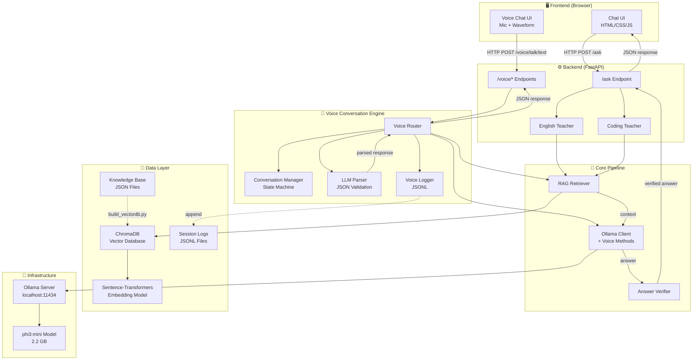
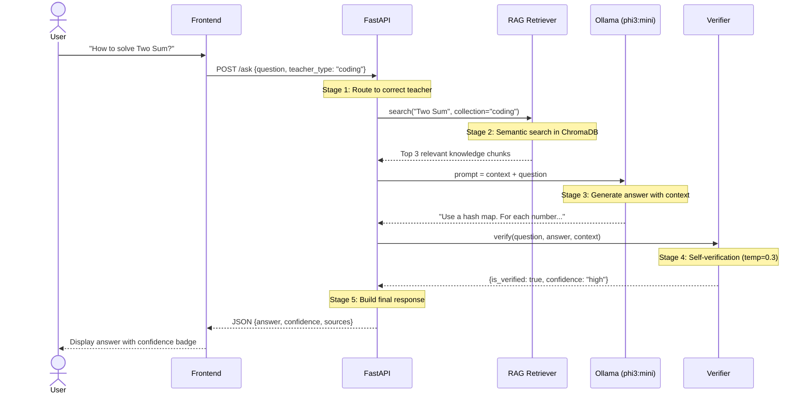
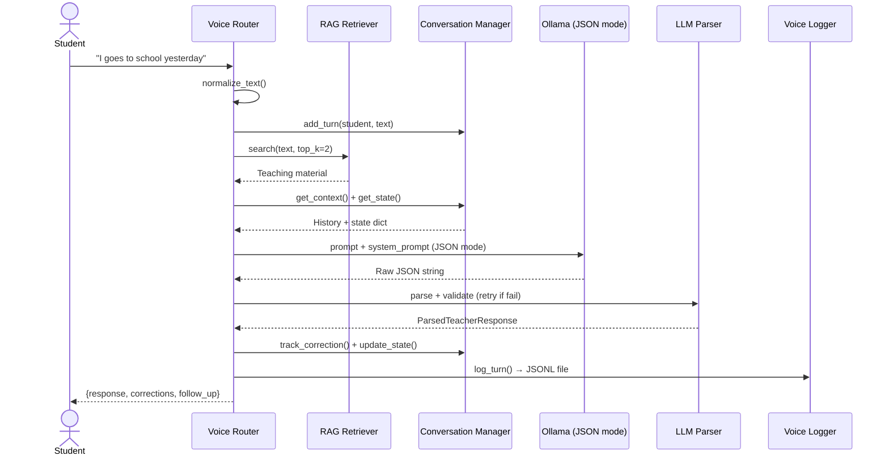

# 🎓 AI Teacher — System Design Document

> A fully local, privacy-first AI teaching system built for learning. No APIs. No cloud. Your laptop is the classroom.

| Spec           | Value                        |
| -------------- | ---------------------------- |
| **Python**     | 3.10 – 3.12 (⚠️ 3.13+ not supported) |
| **Hardware**   | GTX 1650 GPU, 16GB RAM       |
| **LLM**        | phi3:mini via Ollama (local) |
| **Vector DB**  | ChromaDB (local, persistent) |
| **Embeddings** | all-MiniLM-L6-v2 (384-dim)   |
| **Backend**    | Python FastAPI               |
| **Frontend**   | React + Vite + TypeScript    |
| **Styling**    | Tailwind CSS v4 + shadcn/ui  |
| **DevOps**     | Docker, GitHub Actions       |

---

## 1. System Architecture



---

## 2. The Pipeline — How a Question Gets Answered

Every question flows through 5 stages:



### Why this order matters

| Stage               | What                        | Why                                           | Without it                         |
| ------------------- | --------------------------- | --------------------------------------------- | ---------------------------------- |
| **1. Route**        | Pick English/Coding teacher | Different system prompts, different knowledge | Wrong personality, wrong data      |
| **2. RAG Search**   | Find relevant knowledge     | Give LLM factual reference material           | Hallucination — LLM makes stuff up |
| **3. LLM Generate** | Create answer with context  | Context = "open book exam" for the AI         | Unreliable answers                 |
| **4. Verify**       | Double-check the answer     | Catch obvious factual errors                  | Wrong info reaches the user        |
| **5. Respond**      | Send to user with metadata  | Confidence score helps user judge reliability | User blindly trusts everything     |

---

## 3. Component Deep Dive

### 3.1 RAG Retriever — `backend/app/rag/retriever.py`

**One-line:** Takes a question → finds the most relevant knowledge from ChromaDB.

```
User Question → Embedding Model (text → 384 numbers) → ChromaDB Search → Top 3 Results
```

**Key design decisions:**

| Decision             | Choice           | Rationale                                      |
| -------------------- | ---------------- | ---------------------------------------------- |
| Embedding model      | all-MiniLM-L6-v2 | Only 80MB, runs on CPU, good quality for size  |
| Vector dimensions    | 384              | Balance between accuracy and speed             |
| Top-K results        | 3                | Sweet spot — enough context without noise      |
| Separate collections | english / coding | Prevents cross-contamination of search results |

**Core methods:**

```python
# Search — returns ranked results with distance scores
results = retriever.search("How to reverse linked list?", teacher_type="coding")
# → [{"text": "...", "topic": "Reverse a Linked List", "distance": 0.61}, ...]

# Format — converts results into LLM-readable context
context = retriever.format_context(results)
# → "[Source 1] (Topic: Reverse a Linked List)\n..."
```

**What is "distance"?** Lower = better match. Think of it as GPS distance — 0.6 means very close (similar meaning), 1.5 means far (different topic).

---

### 3.2 Ollama Client — `backend/app/llm/ollama_client.py`

**One-line:** Sends prompts to phi3:mini through Ollama's local REST API, gets answers back.

```
[System Prompt + Prompt + Temperature] → Ollama API → phi3:mini → Answer Text
```

**Two modes of operation:**

| Mode | Method | Output | Timeout | Use Case |
|------|--------|--------|---------|----------|
| **Text Chat** | `generate()` | Free text | 120s | `/ask` endpoint |
| **Voice Chat** | `generate_voice_response()` | Forced JSON | 60s | `/voice/talk/text` |

**Voice-specific methods:**

| Method | Purpose |
|--------|---------|
| `generate_voice_response()` | JSON-mode LLM call with 60s timeout + fallback |
| `build_voice_conversation_prompt()` | Emma teacher's system prompt + conversation state + RAG context |
| `build_voice_retry_prompt()` | Stricter prompt for retry when JSON parse fails |

**Prompt Engineering — the most underrated skill:**

```
❌ BAD PROMPT:   "Two Sum bata"
✅ GOOD PROMPT:  System: "You are a coding tutor."
                 User: "Using this reference: [RAG context]
                        Explain Two Sum step by step"
```

**Temperature explained:**

```
🧊 0.0 ──── 0.3 ──── 0.5 ──── 0.7 ──── 1.0 🔥
   |          |         |         |         |
 Robotic   Verifier  Retry     Teacher   Poet
 (exact)   (strict)  (voice)   (our     (wild)
                                pick)
```

---

### 3.3 Answer Verifier — `backend/app/verification/verifier.py`

**One-line:** Takes LLM's answer → asks the same LLM "is this correct?" → returns confidence score.

```
LLM's Answer → Verification Prompt → Same LLM (temp=0.3) → Parse → Verdict
  CORRECT       → ✅ confidence: high
  PARTIALLY     → ⚠️ confidence: medium
  INCORRECT     → ❌ confidence: low + corrected answer
```

**Why temp=0.3 for verification?** Verification needs to be strict — no creativity. Like a math teacher grading papers.

> ⚠️ **Note:** Self-verification is NOT 100% reliable (same LLM checks itself). But it catches ~60-70% of obvious errors.

---

### 3.4 Teachers — `backend/app/teachers/`

**One-line:** Each teacher is a personality wrapper around the same RAG+LLM+Verifier pipeline.

| File                 | Class            | System Prompt                                              | Knowledge Collection |
| -------------------- | ---------------- | ---------------------------------------------------------- | -------------------- |
| `english_teacher.py` | `EnglishTeacher` | "Friendly English teacher, correct grammar, give examples" | `english_knowledge`  |
| `coding_teacher.py`  | `CodingTeacher`  | "Coding tutor, explain DSA, mention complexity"            | `coding_knowledge`   |

**Design Pattern — Duck Typing:**

```python
# Both teachers have the SAME method signature:
english_teacher.ask(question) → {answer, confidence, sources, ...}
coding_teacher.ask(question)  → {answer, confidence, sources, ...}

# So main.py doesn't care WHICH teacher — just call .ask()!
teacher = pick_teacher(teacher_type)  # could be either
result = teacher.ask(question)        # same interface!
```

---

### 3.5 FastAPI Application — `backend/app/main.py`

**One-line:** The entry point that receives HTTP requests, routes to the correct teacher, and returns JSON responses.

**Endpoints:**

| Method | Path | Purpose | Request Body |
|--------|------|---------|--------------|
| `GET` | `/health` | Check if server + Ollama are running | None |
| `POST` | `/ask` | Ask a question to a teacher | `{question, teacher_type, verify}` |
| `POST` | `/ask/stream` | Streaming response (SSE) | `{question, teacher_type, verify}` |
| `POST` | `/voice/start` | Start a new voice session | `{student_level}` |
| `POST` | `/voice/talk/text` | **Core** — text conversation with Emma | `{session_id, text}` |
| `GET` | `/voice/history/{id}` | Get conversation history | Path param |
| `GET` | `/voice/corrections/{id}` | Get correction report card | Path param |

**Key concepts used:**

- **Pydantic BaseModel** — validates request/response format automatically
- **CORS Middleware** — allows frontend (different port) to talk to backend
- **Startup Event** — loads models once at server start, not per-request
- **HTTPException** — proper error responses with status codes
- **APIRouter** — groups voice endpoints under `/voice/` prefix

**Startup flow:**

```
Server starts → Load RAGRetriever (embedding model + ChromaDB)
             → Load OllamaClient (connect to Ollama)
             → Load AnswerVerifier (uses OllamaClient)
             → Create EnglishTeacher (gets all 3 components)
             → Create CodingTeacher (gets all 3 components)
             → Init VoiceRouter (connect retriever + llm_client)
             → Mount voice router at /voice/*
             → Ready to serve requests!
```

---

### 3.6 Voice Conversation Engine — `backend/app/voice/`

**One-line:** A multi-turn, state-aware voice English teaching system with intelligent correction tracking, adaptive difficulty, and structured logging.



**Component breakdown:**

| File | Class/Functions | Responsibility |
|------|-----------------|----------------|
| `conversation_manager.py` | `ConversationManager`, `ConversationSession`, `ConversationState` | Session state machine, error tracking, debouncing, level adjustment |
| `llm_parser.py` | `parse_llm_response_with_retry()`, `normalize_text()` | JSON parse chain (direct → regex → retry → fallback), strict enum validation |
| `logger.py` | `VoiceLogger` | JSONL structured logging per session with latency tracking |
| `voice_router.py` | FastAPI `APIRouter` with 4 endpoints | Orchestrator — ties all components together |
| `ollama_client.py` | `generate_voice_response()`, `build_voice_conversation_prompt()` | JSON-mode LLM calls + Emma's system prompt |

**Error tracking & adaptive learning:**

```
Student makes mistake → Correction tracked (with ErrorType enum)
                      → Mistake count incremented
                      → Same mistake 2+ times? → State switches to grammar_drill
                      → Error rate calculated over last 10 turns
                      → Student level auto-adjusts (beginner/intermediate/advanced)
```

**ErrorType enum (12 categories):**

`tense_agreement` · `article_usage` · `preposition` · `subject_verb_agreement` · `word_order` · `pluralization` · `pronoun_usage` · `vocabulary_choice` · `spelling` · `punctuation` · `sentence_structure` · `other`

**Correction schema (enforced via strict validation):**

```json
{
  "response": "Yesterday is past tense. Use 'went' for past actions.",
  "corrections": [{
    "original": "I goes to school yesterday",
    "corrected": "I went to school yesterday",
    "error_type": "tense_agreement",
    "explanation": "Use 'went' for past actions."
  }],
  "follow_up_question": "Can you form another sentence in past tense?"
}
```

**Safety guardrails:**

| Guardrail | What | Why |
|-----------|------|-----|
| Max 2 corrections/turn | Cap corrections array | Don't overwhelm student |
| Correction debouncing | Skip if same error corrected last turn | Avoid repetitive feedback |
| 80-word response cap | Truncate at sentence boundary | Voice output must be concise |
| Grammar drill loop guard | Max 3 turns in drill mode | Prevent getting stuck |
| Empty/silence handling | Fallback prompt if no input | Never crash on empty |
| 60s LLM timeout | Return fallback JSON | Student shouldn't wait forever |
| JSON retry | Stricter prompt on parse failure | LLMs sometimes break format |
| Strict enum validation | Reject unknown error_type | Protect tracking integrity |

---

## 4. Data Architecture

### Knowledge Base Stats

| Collection | Items | Categories                                                                                       |
| ---------- | ----- | ------------------------------------------------------------------------------------------------ |
| English    | 14    | Grammar (7), Vocabulary (3), Conversation (3), Writing (1)                                       |
| Coding     | 14    | Arrays (3), Strings (2), Linked List (2), Stack (1), Trees (2), DP (2), Search (1), Hash Map (1) |

### Coding Knowledge Item Schema

```json
{
  "id": "dsa_array_001",
  "topic": "Arrays - Two Sum",
  "category": "arrays",
  "difficulty": "easy",
  "question": "Given an array...",
  "hints": ["Hint 1", "Hint 2"],
  "solution": "def two_sum(nums, target): ...",
  "explanation": "We use a hash map...",
  "time_complexity": "O(n)",
  "space_complexity": "O(n)"
}
```

---

## 5. Project Structure

```
ai-teacher/
├── backend/
│   ├── app/
│   │   ├── config.py                 # All settings in one place
│   │   ├── main.py                   # FastAPI app — entry point
│   │   ├── rag/retriever.py          # Semantic search
│   │   ├── llm/ollama_client.py      # Talk to phi3:mini
│   │   ├── verification/verifier.py  # Double-check answers
│   │   ├── teachers/
│   │   │   ├── english_teacher.py    # English teacher personality
│   │   │   └── coding_teacher.py     # Coding teacher personality
│   │   ├── services/                 # Business logic (future)
│   │   └── voice/                    # 🎤 Voice Conversation Engine
│   │       ├── __init__.py
│   │       ├── conversation_manager.py  # State machine + error tracking
│   │       ├── llm_parser.py            # JSON parse + validate + retry
│   │       ├── logger.py                # JSONL structured logging
│   │       └── voice_router.py          # API endpoints (the orchestrator)
│   ├── data/kb/                      # Knowledge base JSONs
│   ├── chroma_db/                    # Vector database (auto-generated)
│   ├── logs/voice_sessions/          # Session logs (JSONL, gitignored)
│   └── scripts/                      # Setup & utility scripts
├── frontend/                         # React + Vite + TypeScript
│   ├── src/
│   │   ├── main.tsx                  # React entry point
│   │   ├── App.tsx                   # Root component
│   │   ├── index.css                 # Global styles + Tailwind
│   │   ├── components/               # Reusable UI blocks
│   │   ├── pages/                    # Full pages (Chat, Topics)
│   │   └── services/                 # API communication layer
│   ├── package.json                  # Node dependencies
│   └── vite.config.ts                # Vite configuration
├── docs/                             # This documentation
├── docker-compose.yml                # Container orchestration
├── .github/workflows/                # CI/CD pipelines
├── requirements.txt
└── README.md
```

---

## 6. Complete Tech Stack

### Frontend

| Technology     | Version | Purpose                                           |
| -------------- | ------- | ------------------------------------------------- |
| React          | 19.x    | UI framework — component-based architecture       |
| Vite           | 7.x     | Build tool — blazing fast HMR, instant dev server |
| TypeScript     | 5.x     | Type safety — catch bugs at compile time          |
| Tailwind CSS   | v4      | Utility-first CSS — rapid UI development          |
| shadcn/ui      | latest  | Premium UI components — buttons, dialogs, cards   |
| Framer Motion  | 12.x    | Smooth animations — transitions, gestures         |
| Zustand        | 5.x     | State management — simple, fast, 10-line setup    |
| React Router   | v7      | Page routing — Topics page, Chat page             |
| Lucide React   | latest  | Icon library — 1500+ clean icons                  |
| Axios          | 1.x     | HTTP client — API calls with interceptors         |
| TanStack Query | v5      | Server state — caching, retries, loading states   |
| Vitest         | latest  | Unit testing — fast, Vite-native                  |

### Backend

| Technology                 | Purpose                            |
| -------------------------- | ---------------------------------- |
| Python 3.10–3.12           | ⚠️ 3.13+ breaks ChromaDB (Pydantic v1 incompatibility) |
| Python FastAPI             | REST API framework                 |
| Ollama + phi3:mini (2.2GB) | Local LLM inference (+ JSON mode for voice) |
| ChromaDB                   | Vector database for RAG            |
| Sentence-Transformers      | Text embeddings (all-MiniLM-L6-v2) |
| Pydantic                   | Request/response validation        |
| Pytest                     | Backend unit testing               |

### DevOps & Infrastructure

| Technology          | Purpose                                           | Cost                  |
| ------------------- | ------------------------------------------------- | --------------------- |
| Docker + Compose    | Containerization — consistent env across machines | Free                  |
| GitHub Actions      | CI/CD — auto test + lint on every push            | Free (2000 min/month) |
| Husky + lint-staged | Pre-commit hooks — check code before commit       | Free                  |
| ESLint + Prettier   | Code quality + auto-formatting                    | Free                  |
| Vercel              | Frontend hosting (production)                     | Free tier             |
| Railway / Render    | Backend hosting (production)                      | Free tier             |

### Future Additions

| Technology        | Purpose             | Status |
| ----------------- | ------------------- | ------ |
| edge-tts          | Text-to-speech (streaming) | 🔜 Next |
| Whisper           | Speech-to-text      | 🔜 Next |
| React Three Fiber | 3D avatar rendering | 🔲 Future |
| Ready Player Me   | Avatar generator    | 🔲 Future |
| Rhubarb Lip Sync  | Avatar lip syncing  | 🔲 Future |

---

## 7. DevOps Pipeline

```
Developer pushes code
        ↓
Husky (pre-commit)
├── ESLint check (code quality)
├── Prettier format (code style)
└── Type check (TypeScript)
        ↓
GitHub Actions (CI)
├── Install dependencies
├── Run linter
├── Run frontend tests (Vitest)
├── Run backend tests (Pytest)
└── Build check (npm run build)
        ↓
Deploy (CD) — on main branch
├── Frontend → Vercel (auto-deploy)
└── Backend → Railway / Render
```

---

## 8. Design Patterns

| Pattern                    | Where                          | What it does                                |
| -------------------------- | ------------------------------ | ------------------------------------------- |
| **RAG**                    | Retriever + LLM                | Grounds LLM responses in factual data       |
| **Self-Verification**      | Verifier                       | Same LLM reviews its own answer             |
| **Dependency Injection**   | Verifier takes LLM client, Voice Router takes retriever + llm | Swap components without changing consumer code |
| **Duck Typing**            | EnglishTeacher / CodingTeacher | Same `.ask()` interface, different behavior |
| **State Machine**          | ConversationManager            | Mode transitions: free_talk → grammar_drill → free_talk |
| **Sliding Window Memory**  | ConversationSession            | Cap at 16 turns + LLM summary for older context |
| **Strict Enum Validation** | LLM Parser                     | Reject unknown error_type — protect tracking integrity |
| **Graceful Degradation**   | LLM Parser, Logger             | Never crash — fallback responses, swallowed log errors |
| **Component Architecture** | React frontend                 | Reusable, isolated UI blocks                |
| **Single Source of Truth** | config.py, Zustand stores      | All settings/state in one place             |
| **Pipeline**               | RAG → LLM → Verify / Parse     | Each stage transforms data for the next     |
| **Separation of Concerns** | rag/ llm/ verification/ voice/ | Each module does ONE job well               |

---

## 9. Build Progress

| Phase             | Step                  | Status     | Tech                           |
| ----------------- | --------------------- | ---------- | ------------------------------ |
| **Foundation**    | 1. Ollama test        | ✅ Done    | `scripts/test_ollama.py`       |
|                   | 2. Knowledge Base     | ✅ Done    | `data/kb/*.json`               |
|                   | 3. Vector DB          | ✅ Done    | `scripts/build_vectordb.py`    |
| **Core Pipeline** | 4. RAG Retriever      | ✅ Done    | `app/rag/retriever.py`         |
|                   | 5. LLM Client         | ✅ Done    | `app/llm/ollama_client.py`     |
|                   | 6. Verifier           | ✅ Done    | `app/verification/verifier.py` |
| **API**           | 7. FastAPI            | ✅ Done    | `app/main.py`                  |
|                   | 8. Teachers           | ✅ Done    | `app/teachers/*.py`            |
| **Voice Engine**  | 9. Conversation Mgr   | ✅ Done    | `voice/conversation_manager.py` |
|                   | 10. LLM Parser        | ✅ Done    | `voice/llm_parser.py`          |
|                   | 11. Voice Logger      | ✅ Done    | `voice/logger.py`              |
|                   | 12. Voice Prompts     | ✅ Done    | `llm/ollama_client.py` (voice methods) |
|                   | 13. Voice Router      | ✅ Done    | `voice/voice_router.py`        |
|                   | 14. Text endpoint     | ✅ Tested  | `/voice/talk/text` working     |
| **Frontend**      | 15. React+Vite setup  | ✅ Done    | TypeScript template            |
|                   | 16. Tailwind + shadcn | ✅ Done    | Tailwind v4, shadcn Nova       |
|                   | 17. Chat UI           | ✅ Done    | Components + Zustand + API     |
|                   | 18. Voice Chat UI     | 🔲 Planned | Mic button + waveform          |
|                   | 19. Topics UI         | 🔲 Planned | Udemy-style course view        |
| **Voice I/O**     | 20. STT (Whisper)     | 🔲 Next    | Speech-to-text                 |
|                   | 21. TTS (edge-tts)    | 🔲 Next    | Text-to-speech streaming       |
|                   | 22. Full voice flow   | 🔲 Next    | `/voice/talk` endpoint         |
| **DevOps**        | 23. Docker            | 🔲 Planned | Containerization               |
|                   | 24. GitHub Actions    | 🔲 Planned | CI/CD pipeline                 |
| **Avatar**        | 25. 3D Avatar         | 🔲 Future  | React Three Fiber              |

---

## 10. Performance Benchmarks

Tested on GTX 1650, 16GB RAM, phi3:mini (2.2GB):

| Operation                      | Time   | Notes                                   |
| ------------------------------ | ------ | --------------------------------------- |
| RAG Search                     | ~0.5s  | Embedding model cached after first load |
| LLM Generation (no verify)     | ~30s   | Single inference pass                   |
| LLM Generation (with verify)   | ~60s   | Two inference passes                    |
| **Voice LLM (JSON mode)**      | **~7s**  | **JSON-forced output, 512 max tokens** |
| **Voice total (end-to-end)**   | **~21s** | **RAG + LLM + parse + state update**   |
| Server startup                 | ~10s   | Model loading + ChromaDB connection     |
| Embedding model first download | ~10s   | 80MB, cached after first run            |

---

## 11. Quick Reference Commands

```bash
# ── Backend ──
ollama serve                                          # Start LLM server
source venv/Scripts/activate                          # Activate Python env
python backend/scripts/build_vectordb.py              # Build vector DB
uvicorn backend.app.main:app --reload --port 8000     # Start API server

# ── Frontend ──
cd frontend && npm run dev                            # Start React dev server
npm run build                                         # Production build → dist/

# ── Voice Endpoints ──
curl http://localhost:8000/voice/start -X POST -H "Content-Type: application/json" -d '{"student_level": "beginner"}'
curl http://localhost:8000/voice/talk/text -X POST -H "Content-Type: application/json" -d '{"session_id": "SESSION_ID", "text": "I goes to school yesterday"}'
curl http://localhost:8000/voice/corrections/SESSION_ID
curl http://localhost:8000/voice/history/SESSION_ID

# ── Test URLs ──
# Backend Health:  http://localhost:8000/health
# Backend Swagger: http://localhost:8000/docs
# Frontend:        http://localhost:5173
```

---

## 12. Bugs Found & Fixed

| Bug                                   | Where                                     | Fix                                     | Lesson                                       |
| ------------------------------------- | ----------------------------------------- | --------------------------------------- | -------------------------------------------- |
| `is_verified: true` when verify=false | `english_teacher.py`, `coding_teacher.py` | Changed default to `is_verified: False` | Default values must reflect actual state     |
| `coding_tutor` variable not found     | `main.py`                                 | Renamed to `coding_teacher`             | Always rename in ALL places when refactoring |

---

_This document is updated as the project progresses. Last updated: Step 14 — Voice Conversation Engine complete, `/voice/talk/text` endpoint tested & working._
