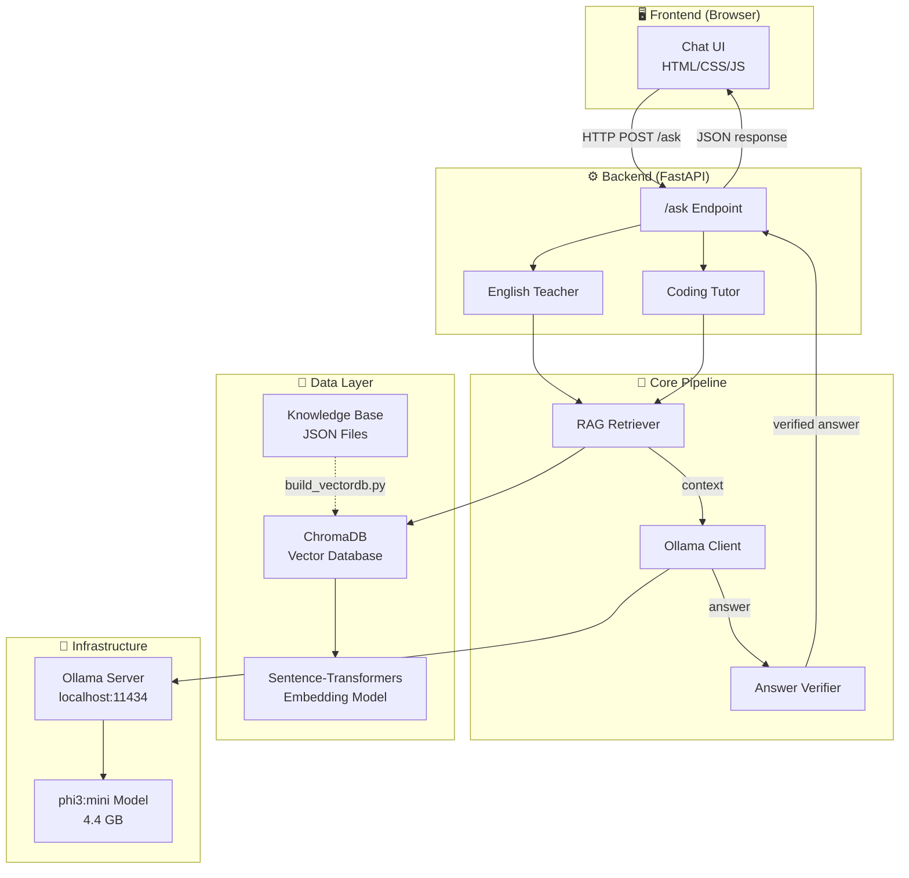
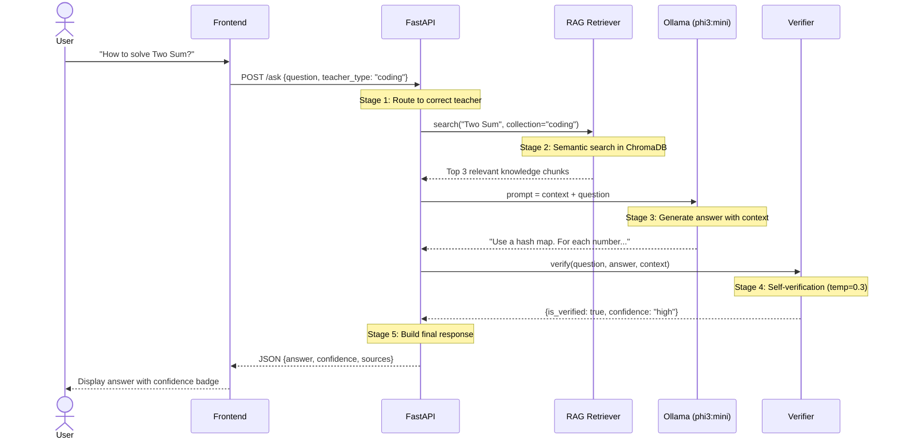

# 🎓 AI Teacher — System Design Document

> A fully local, privacy-first AI teaching system built for learning. No APIs. No cloud. Your laptop is the classroom.

| Spec | Value |
|---|---|
| **Hardware** | GTX 1650 GPU, 16GB RAM |
| **LLM** | phi3:mini via Ollama (local) |
| **Vector DB** | ChromaDB (local, persistent) |
| **Embeddings** | all-MiniLM-L6-v2 (384-dim) |
| **Backend** | Python FastAPI |
| **Frontend** | Vanilla HTML/CSS/JS |

---

## 1. System Architecture



---

## 2. The Pipeline — How a Question Gets Answered

Every question flows through 5 stages:



### Why this order matters

| Stage | What | Why | Without it |
|---|---|---|---|
| **1. Route** | Pick English/Coding teacher | Different system prompts, different knowledge | Wrong personality, wrong data |
| **2. RAG Search** | Find relevant knowledge | Give LLM factual reference material | Hallucination — LLM makes stuff up |
| **3. LLM Generate** | Create answer with context | Context = "open book exam" for the AI | Unreliable answers |
| **4. Verify** | Double-check the answer | Catch obvious factual errors | Wrong info reaches the user |
| **5. Respond** | Send to user with metadata | Confidence score helps user judge reliability | User blindly trusts everything |

---

## 3. Component Deep Dive

### 3.1 RAG Retriever — `backend/app/rag/retriever.py`

**One-line:** Takes a question → finds the most relevant knowledge from ChromaDB.

```
User Question → Embedding Model (text → 384 numbers) → ChromaDB Search → Top 3 Results
```

**Key design decisions:**

| Decision | Choice | Rationale |
|---|---|---|
| Embedding model | all-MiniLM-L6-v2 | Only 80MB, runs on CPU, good quality for size |
| Vector dimensions | 384 | Balance between accuracy and speed |
| Top-K results | 3 | Sweet spot — enough context without noise |
| Separate collections | english / coding | Prevents cross-contamination of search results |

**Core methods:**

```python
# Search — returns ranked results with distance scores
results = retriever.search("How to reverse linked list?", teacher_type="coding")
# → [{"text": "...", "topic": "Reverse a Linked List", "distance": 0.61}, ...]

# Format — converts results into LLM-readable context
context = retriever.format_context(results)
# → "[Source 1] (Topic: Reverse a Linked List)\n..."
```

**What is "distance"?** Lower = better match. Think of it as GPS distance — 0.6 means very close (similar meaning), 1.5 means far (different topic).

---

### 3.2 Ollama Client — `backend/app/llm/ollama_client.py`

**One-line:** Sends prompts to phi3:mini through Ollama's local REST API, gets answers back.

```
[System Prompt + Prompt + Temperature] → Ollama API → phi3:mini → Answer Text
```

**Prompt Engineering — the most underrated skill:**

```
❌ BAD PROMPT:   "Two Sum bata"
✅ GOOD PROMPT:  System: "You are a coding tutor."
                 User: "Using this reference: [RAG context]
                        Explain Two Sum step by step"
```

**Temperature explained:**

```
🧊 0.0 ──── 0.3 ──── 0.5 ──── 0.7 ──── 1.0 🔥
   |          |         |         |         |
 Robotic   Verifier  Balanced  Teacher   Poet
 (exact)   (strict)            (our     (wild)
                                pick)
```

---

### 3.3 Answer Verifier — `backend/app/verification/verifier.py`

**One-line:** Takes LLM's answer → asks the same LLM "is this correct?" → returns confidence score.

```
LLM's Answer → Verification Prompt → Same LLM (temp=0.3) → Parse → Verdict
  CORRECT       → ✅ confidence: high
  PARTIALLY     → ⚠️ confidence: medium
  INCORRECT     → ❌ confidence: low + corrected answer
```

**Why temp=0.3 for verification?** Verification needs to be strict — no creativity. Like a math teacher grading papers.

> ⚠️ **Note:** Self-verification is NOT 100% reliable (same LLM checks itself). But it catches ~60-70% of obvious errors.

---

## 4. Data Architecture

### Knowledge Base Stats

| Collection | Items | Categories |
|---|---|---|
| English | 14 | Grammar (7), Vocabulary (3), Conversation (3), Writing (1) |
| Coding | 14 | Arrays (3), Strings (2), Linked List (2), Stack (1), Trees (2), DP (2), Search (1), Hash Map (1) |

### Coding Knowledge Item Schema

```json
{
  "id": "dsa_array_001",
  "topic": "Arrays - Two Sum",
  "category": "arrays",
  "difficulty": "easy",
  "question": "Given an array...",
  "hints": ["Hint 1", "Hint 2"],
  "solution": "def two_sum(nums, target): ...",
  "explanation": "We use a hash map...",
  "time_complexity": "O(n)",
  "space_complexity": "O(n)"
}
```

---

## 5. Project Structure

```
ai-teacher/
├── backend/
│   ├── app/
│   │   ├── config.py                 # All settings in one place
│   │   ├── rag/retriever.py          # Semantic search
│   │   ├── llm/ollama_client.py      # Talk to phi3:mini
│   │   ├── verification/verifier.py  # Double-check answers
│   │   ├── teachers/                 # Teacher personalities (coming)
│   │   ├── services/                 # Business logic (coming)
│   │   └── voice/                    # Whisper + Piper TTS (future)
│   ├── data/kb/                      # Knowledge base JSONs
│   ├── chroma_db/                    # Vector database (auto-generated)
│   └── scripts/                      # Setup & utility scripts
├── frontend/                         # Chat UI (coming)
├── docs/                             # This documentation
├── requirements.txt
└── README.md
```

---

## 6. Design Patterns

| Pattern | Where | What it does |
|---|---|---|
| **RAG** | Retriever + LLM | Grounds LLM responses in factual data |
| **Self-Verification** | Verifier | Same LLM reviews its own answer |
| **Dependency Injection** | Verifier takes LLM client | Swap LLM without changing verifier code |
| **Single Source of Truth** | config.py | All settings in one file |
| **Pipeline** | RAG → LLM → Verify | Each stage transforms data for the next |
| **Separation of Concerns** | rag/ llm/ verification/ | Each module does ONE job well |

---

## 7. Build Progress

| Phase | Step | Status | File |
|---|---|---|---|
| **Foundation** | 1. Ollama test | ✅ Done | `scripts/test_ollama.py` |
| | 2. Knowledge Base | ✅ Done | `data/kb/*.json` |
| | 3. Vector DB | ✅ Done | `scripts/build_vectordb.py` |
| **Core Pipeline** | 4. RAG Retriever | ✅ Done | `app/rag/retriever.py` |
| | 5. LLM Client | ✅ Done | `app/llm/ollama_client.py` |
| | 6. Verifier | ✅ Done | `app/verification/verifier.py` |
| **API + UI** | 7. FastAPI | 🔲 Next | `app/main.py` |
| | 8. Teachers | 🔲 Next | `app/teachers/*.py` |
| | 9. Frontend | 🔲 Planned | `frontend/*` |
| **Voice** | 10. Whisper+Piper | 🔲 Future | `app/voice/*` |

---

## 8. Quick Reference Commands

```bash
# Start Ollama
ollama serve

# Activate venv
source venv/Scripts/activate

# Build vector database (run after adding new knowledge)
python backend/scripts/build_vectordb.py

# Start API server (after Step 7)
uvicorn backend.app.main:app --reload --port 8000
```

---

*This document is updated as the project progresses. Last updated: Step 6 complete.*
